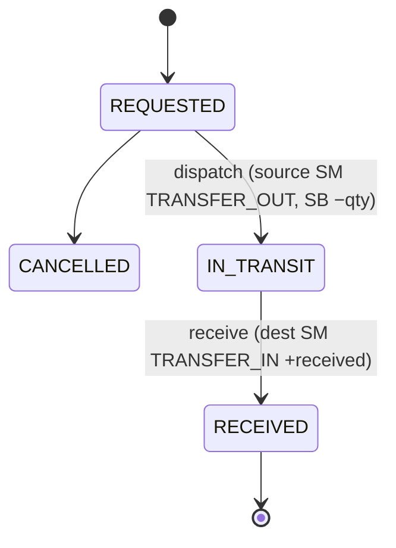

# Phase 0 — Core workflows and their effects

Exit criterion for Phase 0: *the team can explain how a sale, refund, purchase receipt and stock
transfer affect inventory and financial records without ambiguity.* Each workflow below is one
database transaction unless stated.

Legend: **SM** = `stock_movements` row (append-only), **SB** = `stock_balances` update.

## 1. Sale (online)

```mermaid
sequenceDiagram
  participant POS
  participant API
  participant DB
  POS->>API: POST /sales (Idempotency-Key, lines, tenders)
  API->>DB: BEGIN
  API->>DB: idempotency_records insert (key unique) — if exists, return stored response
  API->>DB: load prices/tax for store (server is source of truth)
  API->>DB: SELECT stock_balances … FOR UPDATE (each product)
  API->>DB: insert sale, sale_items (price/discount/HSN/tax snapshots)
  API->>DB: SM: SALE −qty per line (batch if tracked); SB −qty
  API->>DB: invoice_sequences next number → invoices
  API->>DB: sale_payments (cash/credit settled; UPI/card per verification)
  API->>DB: COMMIT
  API-->>POS: 201 sale + invoice (print data)
```

| Effect | Record |
| --- | --- |
| Inventory | SM `SALE` per line, SB decreases; batch qty decreases |
| Money | `sale_payments`; cash adds to the open `cash_session` expected cash |
| Credit tender | customer receivable increases |
| Tax | invoice stores taxable, CGST/SGST or IGST per slab |
| Failure | any error → ROLLBACK; nothing partial. Insufficient stock → 409 `STOCK_INSUFFICIENT` |

## 2. Return / refund

* Allowed only against an existing invoice; quantity ≤ sold − already returned (per line).
* Refund value uses the **original** line snapshot (price after discounts), never current price.
* Creates `sale_returns` + items + a **credit note** number.
* Inventory: SM `SALE_RETURN` +qty **only** for resaleable reasons; `DAMAGED` / `EXPIRED`
  returns post SM `SALE_RETURN` then SM `WRITE_OFF` (net zero sellable, but traceable).
* Money: refund tender recorded (cash out of drawer / UPI refund / credit reduces khata).

## 3. Purchase order → goods receipt (GRN)

* PO has no stock effect. Status: `DRAFT → SENT → PARTIAL → RECEIVED | CANCELLED` (derived from GRNs).
* GRN lines: ordered, received, damaged, **accepted = received − damaged**.
* Inventory: SM `PURCHASE_RECEIPT` +accepted (with batch & expiry); SB +accepted; weighted-average
  cost updated.
* Damaged qty never enters stock; it can feed a purchase return.
* Supplier bill (invoice) records the payable: `supplier_transactions` +amount.
  Three-way match (PO price / GRN qty / bill) flags mismatches — doesn't block.

## 4. Purchase return / supplier payment

* Purchase return: SM `PURCHASE_RETURN` −qty (from stock) and a **debit note**; payable −value.
* Supplier payment: `supplier_payments` + allocation to bills; payable −amount. No stock effect.

## 5. Stock adjustment and physical count

* Adjustment has a reason (`DAMAGE`, `EXPIRY`, `THEFT`, `COUNT_CORRECTION`, `OPENING`, `OTHER`).
* Value above tenant threshold → `PENDING_APPROVAL`; stock changes only when approved.
* Physical count: snapshot system qty at count start → counted qty → approve → SM
  `COUNT_ADJUSTMENT` for each difference.
* Opening stock is SM `OPENING`.
* Corrections are **new** movements; historical SMs are never edited.

## 6. Branch stock transfer



* In-transit quantity = dispatched − received; shown separately, not in either branch's sellable stock.
* Shortfall on receipt (sent 30, received 28) → SM `TRANSFER_LOSS` 2 against the transfer, value
  reported.
* Document: same GSTIN → delivery challan; different GSTIN → tax invoice (+ e-way bill > ₹50,000).
  Cross-GSTIN transfers are taxable supplies at cost value.

## 7. Cash session (counter shift)

`OPEN (float) → … sales/refunds/cash-in/cash-out … → CLOSING (counted) → CLOSED`.
Expected = float + cash sales − cash refunds ± cash movements. Variance stored; manager approval
required if |variance| > tenant threshold.

## Stock movement types

`OPENING, PURCHASE_RECEIPT, PURCHASE_RETURN, SALE, SALE_RETURN, ADJUSTMENT, COUNT_ADJUSTMENT,
WRITE_OFF, TRANSFER_OUT, TRANSFER_IN, TRANSFER_LOSS`.

Invariant (tested in Phase 5): for every (store, product, batch),
`stock_balances.qty = Σ stock_movements.qty`.
