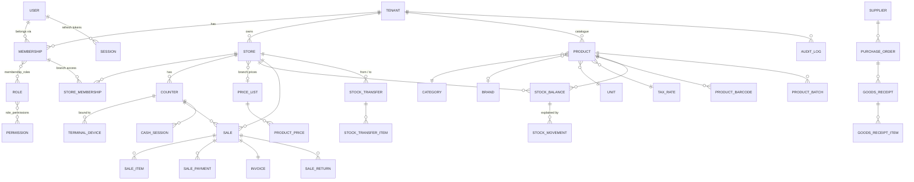

# Phase 0 — Initial ERD and data dictionary

The Prisma schema (`backend/prisma/schema.prisma`) is the source of truth; this document is the
agreed shape it grows into phase by phase. Every tenant-owned table carries `tenant_id`;
branch-owned tables also carry `store_id`.

## Data dictionary (Phase 2–7 tables; later phases are added with their migrations)

| Table | Key columns | Notes |
| --- | --- | --- |
| `tenants` | id (uuid), slug (unique), display_name, legal_name, business_type, registration (`REGULAR`/`COMPOSITION`/`UNREGISTERED`), gstin, state_code, settings (jsonb), status | One business. Business profile fields from the frontend's `BusinessProfile`. |
| `users` | id, email (unique, citext-like lower), phone (unique nullable), name, password_hash (argon2id), status, email_verified_at | Global identity; can join many tenants. |
| `memberships` | id, tenant_id, user_id, status, pin_hash | Unique (tenant_id, user_id). PIN is per business. |
| `roles` | id, tenant_id (null = system template), key, name | Unique (tenant_id, key). |
| `permissions` | key (pk) | Seeded from the matrix. |
| `role_permissions` | role_id, permission_key | |
| `membership_roles` | membership_id, role_id | |
| `stores` | id, tenant_id, code (2–4), name, kind (`STORE`/`WAREHOUSE`), is_hq, address fields, state_code, gstin, phone, timezone, status (`ACTIVE`/`CLOSED`) | Unique (tenant_id, code). Matches the frontend `Branch`. |
| `store_memberships` | membership_id, store_id | Branch access for scoped roles. |
| `counters` | id, tenant_id, store_id, number (1–9), name, status | Unique (store_id, number); number feeds the invoice series. |
| `terminal_devices` | id, tenant_id, store_id, counter_id, name, device_key_hash, last_seen_at, revoked_at | A registered POS computer. |
| `sessions` | id, user_id, tenant_id, family_id, token_hash, expires_at, revoked_at, replaced_by_id, user_agent, ip | Refresh-token rotation with reuse detection. |
| `tax_rates` | id, tenant_id, name, kind (`TAXABLE`/`NIL_RATED`/`EXEMPT`/`NON_GST`), rate, cess_rate, is_active | Rate and cess are 0 unless TAXABLE (CHECK). Sales snapshot the rate (Phase 7). |
| `units` | id, tenant_id, code, name, decimals (0–3), uqc | Unique (tenant_id, code). UQC is the GST quantity code. |
| `categories` | id, tenant_id, parent_id, name, is_active | Max 3 levels; name unique among siblings ignoring case. |
| `brands` | id, tenant_id, name, is_active | Name unique ignoring case. |
| `products` | id, tenant_id, sku, name, receipt_name, category_id, brand_id, unit_id, tax_rate_id, hsn_code, mrp, selling_price, purchase_cost, price_includes_tax, allow_open_price, track_inventory, parent_id, variant_label, image_key, status, version | Unique (tenant_id, sku). selling price ≤ MRP (CHECK). Variants via parent_id. |
| `product_barcodes` | id, tenant_id, product_id, code, pack_qty, label, is_primary | Unique (tenant_id, code); one primary per product. |
| `price_lists` | id, tenant_id, name, is_active | `stores.price_list_id` points at one. |
| `product_prices` | price_list_id, product_id, tenant_id, selling_price | Branch price overrides. |
| `stock_movements` | id, seq, tenant_id, store_id, product_id, batch_id, type, qty (signed), unit_cost, balance_after, ref_type, ref_id, reason, negative, user_id | Append-only (trigger). Σ qty = balance. |
| `stock_balances` | store_id, product_id, tenant_id, qty, avg_cost, reorder_level, reorder_qty, version | Changed only with a movement, in one transaction. |
| `product_batches` / `batch_stocks` | batch: product_id, batch_no, expiry_date, mfg_date; stock: store_id, batch_id, qty | Per-batch stock for `products.tracks_batches`. |
| `stock_adjustments` / `_items` | store_id, reason, status (`PENDING_APPROVAL/POSTED/REJECTED/CANCELLED`), value, created/decided by; items: product, batch, qty, unit_cost | Approval above the tenant limit. |
| `stock_counts` / `_items` | store_id, name, status (`OPEN/SUBMITTED/POSTED/CANCELLED`); items: product, batch, system_qty, counted_qty | Posts COUNT_ADJUSTMENT. |
| `stock_transfers` / `_items` | from/to store, status (`REQUESTED/IN_TRANSIT/RECEIVED/CANCELLED`); items: product, batch, requested/dispatched/received qty, unit_cost | In transit between dispatch and receipt. |
| `suppliers` | id, tenant_id, name, gstin, state_code, credit_days, balance, status | Name unique ignoring case. Balance = Σ supplier_transactions. |
| `supplier_products` | supplier_id, product_id, supplier_sku, cost, last_purchased_at | Supplier-specific purchase prices. |
| `supplier_transactions` | id, seq, supplier_id, type (`OPENING/PURCHASE/RETURN/PAYMENT/REFUND`), amount, balance_after, date, ref_type, ref_id, ref_no | Append-only payables ledger. |
| `purchase_orders` / `_items` | number, supplier, store, status, dates, GST flags, totals; items: product, qty, rate, discount, GST/cess %, received_qty | No stock effect. |
| `goods_receipts` / `_items` | number, supplier, store, po, supplier invoice no/date, due date, totals, match_issues; items: ordered/received/damaged/accepted qty, rate, batch, unit_cost | Posts stock + payable atomically. |
| `purchase_returns` / `_items` | number (debit note), supplier, store, grn, reason, totals; items: grn_item, from_damaged, qty, rate | |
| `supplier_payments` / `payment_allocations` | number, supplier, direction, amount, mode, reference; allocations to receipts | |
| `document_sequences` | tenant_id, kind, next | Gap-free document numbers. |
| `sales` / `sale_items` | invoice_no, document_type, store, counter, cash_session, cashier, status, payment_status, buyer snapshot, place_of_supply, totals; items: product snapshot (sku, name, HSN, unit), qty, unit_price, MRP, discounts, final, taxable, GST/cess, unit_cost, returned_qty | Never recalculated. |
| `sale_payments` / `payment_transactions` | method, amount, status (`SUCCEEDED/PENDING_VERIFICATION/FAILED/REFUNDED`), tendered, reference; events (append-only) | UPI/card verified server-side. |
| `sale_returns` / `_items` | credit_note_no, reason, totals, refund method/amount/status, approver; items: sale_item, qty, amount, resaleable | |
| `invoices` | kind (`TAX_INVOICE/BILL_OF_SUPPLY/CREDIT_NOTE`), number, sale, return, status, document (JSON) | The issued document, for reprints. |
| `invoice_sequences` | counter_id, fy, kind, next | Per-counter gap-free series. |
| `cash_sessions` / `cash_movements` | store, counter, user, status, float, expected/counted/variance, review; movements PAY_IN/PAY_OUT | One open per counter and per cashier. |
| `idempotency_records` | tenant_id, key, request_hash, status_code, response | First response of an idempotent POST. |
| `audit_logs` | id, tenant_id, actor_user_id, action, entity, entity_id, data (jsonb), request_id, ip, created_at | Append-only. |

Conventions: UUID PKs (`gen_random_uuid()`, or client UUIDv7 for offline records), `created_at` /
`updated_at` `timestamptz` in UTC, money `numeric(12,2)`, quantity `numeric(12,3)`, status columns
are Postgres enums, soft-close instead of hard-delete for anything with history.
